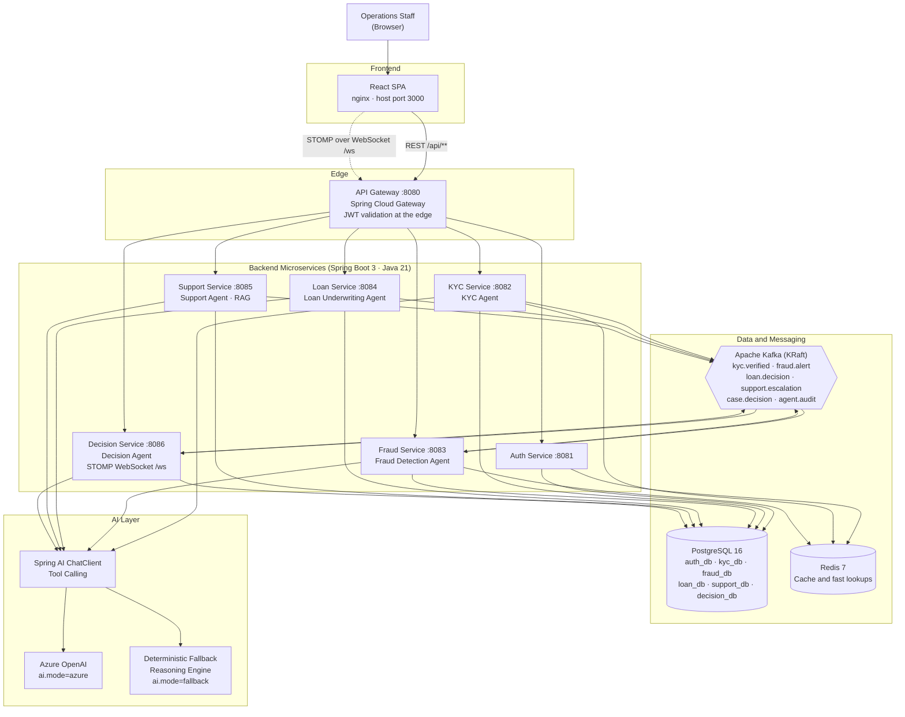

# AI Banking Operations Platform


**An event-driven, microservices banking operations platform where five explainable AI agents — KYC, Fraud Detection, Loan Underwriting, Customer Support, and a Decision orchestrator — do the repetitive analysis work of a bank's back office, while humans stay firmly in the loop for every consequential decision.** Each agent scores, recommends, and shows its reasoning step by step; nothing is auto-approved silently, every action is written to an audit trail, and the whole platform runs anywhere with a single `docker compose up` — no cloud account or API key required, thanks to a deterministic fallback reasoning engine that mirrors the Azure OpenAI path.

> **Built by Sharath Kumar Suram** — Full-Stack Java Developer (Spring Boot, AWS, Microservices)
> [LinkedIn](https://www.linkedin.com/in/sharathkumarsuram/) · [GitHub](https://github.com/Sharathreddysuram)

---

## Table of Contents

- [What the Platform Is and Who It Serves](#what-the-platform-is-and-who-it-serves)
- [Architecture](#architecture)
- [The Five AI Agents](#the-five-ai-agents)
- [AI Layer](#ai-layer)
- [Audit Trail and Human-in-the-Loop](#audit-trail-and-human-in-the-loop)
- [Tech Stack](#tech-stack)
- [Getting Started](#getting-started)
- [Demo Walkthrough](#demo-walkthrough)
- [API Documentation](#api-documentation)
- [Frontend Tour](#frontend-tour)
- [Deployment](#deployment)
- [Project Structure](#project-structure)
- [Key Design Decisions](#key-design-decisions)
- [Future Enhancements](#future-enhancements)
- [License](#license)
- [Author](#author)

---

## What the Platform Is and Who It Serves

A bank's operations floor runs on queues: new customers waiting to be identity-checked, transactions waiting to be screened, loan files waiting for an underwriter, support tickets waiting for an answer, and — behind all of it — a compliance team that has to be able to prove, months later, exactly *why* each decision was made.

The AI Banking Operations Platform models that floor in software. Work arrives as **cases**. An AI agent picks up each case, gathers evidence by calling purpose-built tools (document validation, sanctions screening, transaction history, income assessment, and more), produces a **score, a recommendation, and a human-readable reasoning trace**, and publishes what happened as a Kafka event. A human reviewer sees the agent's work — not just its conclusion — and approves or rejects it. Every step lands in an immutable audit trail.

The platform is deliberately **not** a "black box that approves loans." It is an operations system in which AI does the gathering, checking, scoring, and drafting, and people keep the authority.

### Who it serves — a day in the life

**Operations Manager — starts the day with the whole floor in one view.**
At 9:00 a.m. she opens the Dashboard: overnight, 214 KYC cases were processed, 6 are waiting in `PENDING_REVIEW`, fraud alerts are down from yesterday, and two support tickets were escalated. A live WebSocket notification lands while she watches — a high-severity fraud alert. She reassigns it to the on-duty analyst, checks the Audit Trail page to confirm nothing sat unreviewed overnight, and exports the decision log for the morning stand-up. Her day is exception management, not queue management, because the agents cleared the routine 90%.

**Fraud Analyst — works alerts that arrive pre-investigated.**
Instead of a bare "suspicious transaction" flag, each alert he opens already contains the evidence: the amount is 8.4× the customer's 90-day average, the transaction originated 6,200 km from the previous one 40 minutes earlier (a geo-velocity impossibility), and the device has never been seen on this account. The Fraud Agent's reasoning trace lists each signal and the points it contributed to the risk score of 87/100. He agrees, confirms the alert, and the customer case is updated — his judgment took two minutes because the agent did the twenty minutes of data gathering first.

**Loan Officer — underwrites with the maths already shown.**
A loan application arrives with the underwriting already drafted: verified income, existing monthly obligations, a debt-to-income ratio computed and displayed as a formula — not just a number — a credit-risk band, and a recommended limit. Where the DTI sits just over the policy threshold, the agent recommends a smaller amount rather than a flat decline, and says why. She can approve the recommendation, adjust the amount, or reject it — but she never has to rebuild the analysis from a blank page, and the applicant gets a decision in hours instead of days.

**Compliance Officer — answers auditors without digging through inboxes.**
When an auditor asks "why was this customer onboarded, and who approved it?", he opens the case, reads the KYC Agent's reasoning trace (documents valid, sanctions screening clear, score 92/100), sees the named human who reviewed and approved it, the timestamps, and every Kafka event the case emitted along the way. The same view answers "why was this loan declined?" and "who saw this fraud alert first?" The audit trail is not a report someone compiles — it is a by-product of how the system works.

**Customer Support (and the customer) — instant answers, human escalation.**
Routine questions — "Why was my card declined?", "What documents do I still need?", "How long does underwriting take?" — are answered immediately by the Support Agent, grounded in a curated knowledge base and the customer's own account data. When a conversation involves a disputed charge or genuine distress, the agent recognises that it should not improvise, creates an escalation, and hands the full conversation context to a human agent.

---

## Architecture



### How the pieces talk to each other

The platform uses **synchronous REST where a user is waiting for an answer**, and **asynchronous Kafka events where services need to react to something that happened elsewhere**. That split is the core architectural idea.

**Synchronous — REST through the gateway.** The frontend never calls a service directly. Every request goes to the API Gateway on port 8080, which validates the JWT at the edge (signature, expiry, role claims), then routes to the owning service using the service-URL configuration (`AUTH_SERVICE_URL`, `KYC_SERVICE_URL`, and so on). The Decision Service also calls peer services synchronously when it assembles a case — it needs the KYC, fraud, and loan results *now*, in one response, to make its recommendation. Request/response is the right tool when the caller cannot proceed without the answer.

**Asynchronous — Kafka events for facts, not commands.** When something *has happened*, the owning service publishes an event and moves on. Other services react if they care. This decouples producers from consumers: the KYC service does not need to know that the Decision Service and the audit pipeline are listening, and a slow consumer never blocks a customer's verification.

| Kafka Topic | Published by | Consumed by | Meaning |
|---|---|---|---|
| `kyc.verified` | kyc-service | decision-service, fraud-service | A customer's identity was verified (or failed verification), with the KYC score. Fraud uses it to establish a trusted baseline for the customer. |
| `fraud.alert` | fraud-service | decision-service | A transaction scored above the alert threshold. Carries the risk score, the signals that fired, and the transaction reference. |
| `loan.decision` | loan-service | decision-service | An underwriting recommendation was produced for an application — approve, refer, or decline, with DTI and credit-risk detail. |
| `support.escalation` | support-service | decision-service | A support conversation exceeded what the agent should handle alone and needs a human, with full conversation context. |
| `case.decision` | decision-service | All services (audit consumers) | A decision case reached an outcome — the agent's recommendation and, after review, the human's final decision. |
| `agent.audit` | All services | decision-service (audit trail) | Every agent action, tool call, score, and reasoning trace, recorded for the audit trail regardless of outcome. |

**Real-time — STOMP WebSocket.** The Decision Service hosts a STOMP endpoint at `/ws` (proxied through the gateway). Fraud alerts, new pending cases, and escalation notices are pushed to subscribed browsers the moment they happen, so the operations dashboard behaves like a live floor rather than a page you refresh.

### Per-service responsibilities

| Service | Port | Database | Responsibility |
|---|---|---|---|
| `api-gateway` | 8080 | — (validates against auth configuration) | Single entry point. Routes `/api/**` and `/ws`, validates JWTs at the edge, enforces role-based access per route, and hides the internal topology from clients. |
| `auth-service` | 8081 | `auth_db` | Users, roles, and authentication. Issues and validates JWTs. Owns the demo and staff accounts and the role model (`ADMIN`, `OPS_MANAGER`, `FRAUD_ANALYST`, `LOAN_OFFICER`, `COMPLIANCE_OFFICER`). |
| `kyc-service` | 8082 | `kyc_db` | Customer onboarding and identity verification. Hosts the **KYC Agent**; publishes `kyc.verified`. |
| `fraud-service` | 8083 | `fraud_db` | Transaction ingestion and screening. Hosts the **Fraud Detection Agent**; publishes `fraud.alert` and consumes `kyc.verified` baselines. |
| `loan-service` | 8084 | `loan_db` | Loan applications and underwriting. Hosts the **Loan Underwriting Agent**; publishes `loan.decision`. |
| `support-service` | 8085 | `support_db` | Customer support chat and tickets, with retrieval-augmented answers. Hosts the **Customer Support Agent**; publishes `support.escalation`. |
| `decision-service` | 8086 | `decision_db` | Case orchestration and human review. Hosts the **Decision Agent** and the STOMP WebSocket endpoint at `/ws`; owns the case lifecycle and the audit trail; publishes `case.decision`. |
| `frontend` | 3000 (host) → 80 (container) | — | React single-page application served by nginx. Eight operational pages, JWT-aware API client, live WebSocket notifications. |
| `agent-common` | — (library) | — | Shared module: agent contracts, reasoning-trace and audit event models, tool-calling interfaces, Kafka event schemas, and the fallback reasoning scaffolding every agent builds on. Not a deployable service. |

Shared infrastructure: **PostgreSQL 16** (one instance, one database per service), **Apache Kafka 3.8 in KRaft mode** (single node, no ZooKeeper), and **Redis 7** (caching and fast lookups).

---

## The Five AI Agents

All five agents share the same shape, defined in `agent-common`:

1. **Receive a unit of work** (a customer, a transaction, an application, a message, a case).
2. **Gather evidence by calling tools** — plain Spring beans annotated for Spring AI tool calling, each doing one verifiable job (query a database, run a check, compute a figure).
3. **Score and recommend** — either through Azure OpenAI with those tools available to the model (`ai.mode=azure`), or through the deterministic fallback engine (`ai.mode=fallback`) that applies the same scoring logic in code.
4. **Explain itself** — every response carries a **reasoning trace**: an ordered list of steps, each naming the tool called, what it found, and how it affected the outcome. The trace is stored, displayed in the UI, and emitted on the `agent.audit` topic.
5. **Stop at the human's door** — agents recommend; consequential outcomes require a human review decision (see [Audit Trail and Human-in-the-Loop](#audit-trail-and-human-in-the-loop)).

### 1. KYC Agent — kyc-service

**What it does.** Verifies that a new customer is who they claim to be, that their documents are genuine and consistent, and that they do not appear on sanctions or watch lists. It turns onboarding — traditionally days of document chasing — into a scored, evidence-backed verification completed in minutes for clean cases.

**Tools**

| Tool | Job |
|---|---|
| `DocumentValidationTool` | Checks submitted identity documents: document type and format, expiry, consistency of name and date of birth across documents, and internal integrity checks on document numbers. Returns per-document pass/fail with reasons. |
| `SanctionsScreeningTool` | Screens the customer's name and date of birth against sanctions and watch-list data, including fuzzy name matching for transliteration variants. Returns matches (with match strength) or a clear result. |

**Inputs.** Customer profile (full name, date of birth, address, contact details), document set (type, number, issuing country, expiry), and the onboarding channel.

**Outputs.** A KYC score (0–100), a verification status, per-check results, a reasoning trace, and — on completion — a `kyc.verified` Kafka event.

**Scoring logic.**

| Component | Max points | Notes |
|---|---|---|
| Document validity | 40 | All documents valid, unexpired, and mutually consistent earns full marks; each inconsistency deducts and is named in the trace. |
| Identity data consistency | 30 | Name, date of birth, and address agree across the profile and documents. |
| Sanctions / watch-list screening | 30 | A confirmed sanctions match is a hard stop (score 0 and immediate referral), not a deduction. A fuzzy possible-match deducts and forces human review. |

| Score band | Outcome |
|---|---|
| 85–100 | `VERIFIED` — eligible for automatic completion, still audit-logged. |
| 60–84 | `PENDING_REVIEW` — a compliance reviewer sees the trace and the specific deductions, and decides. |
| Below 60 | `REJECTED` recommendation — referred to a human with the failing checks listed; the agent never silently discards an applicant. |

**Explainability.** The trace shows each check as its own step — "DocumentValidationTool: passport valid, expires 2029-04, name matches profile" / "SanctionsScreeningTool: no match (highest fuzzy similarity 0.31, below 0.80 threshold)" — so a compliance officer can defend the outcome to an auditor without re-running anything.

### 2. Fraud Detection Agent — fraud-service

**What it does.** Screens every ingested transaction in near-real time, compares it against the customer's own established behaviour, and raises a pre-investigated alert when the pattern looks wrong. Its job is not to block banking — it is to make sure a human analyst spends attention where the evidence is strongest.

**Tools**

| Tool | Job |
|---|---|
| `TransactionHistoryTool` | Retrieves the customer's transaction history and computes behavioural baselines: average and maximum amounts over 30/90 days, usual merchants and categories, usual hours, and known devices and locations. |
| `GeoVelocityTool` | Compares the location and timestamp of consecutive transactions and computes whether the implied travel is physically possible (distance ÷ elapsed time against a maximum plausible speed). Flags impossible-travel patterns. |

**Inputs.** A transaction (customer, amount, currency, merchant, category, timestamp, location, device identifier, channel) plus the customer's history and KYC baseline.

**Outputs.** A risk score (0–100), a risk level (`LOW`, `MEDIUM`, `HIGH`, `CRITICAL`), the list of signals that fired with their point contributions, a reasoning trace, and — above the alert threshold — a `fraud.alert` event and a WebSocket notification to the operations floor.

**Scoring logic.** A transparent weighted rules model (the same weights are used by the fallback engine and given to the model as scoring guidance in Azure mode):

| Signal | Weight (max points) | Example trigger |
|---|---|---|
| Amount anomaly vs. customer baseline | 30 | Amount exceeds 5× the 90-day average; points scale with the multiple. |
| Geo-velocity impossibility | 25 | Consecutive transactions imply travel faster than 900 km/h. |
| Unseen device | 15 | Device identifier never previously used by this customer. |
| Unusual time of day | 10 | Transaction far outside the customer's normal active hours. |
| Merchant / category risk | 10 | First-ever transaction in a high-risk category for this customer. |
| Behavioural deviation (combined) | 10 | Multiple smaller deviations (new payee type, atypical channel) accumulating. |

| Score band | Outcome |
|---|---|
| 0–39 | `LOW` — transaction passes, screening result audit-logged. |
| 40–64 | `MEDIUM` — transaction passes, flagged on the customer timeline for pattern review. |
| 65–84 | `HIGH` — alert raised, pushed to analysts over WebSocket. |
| 85–100 | `CRITICAL` — alert raised at highest priority; the linked case is created in `PENDING_REVIEW` for immediate human action. |

**Explainability.** Analysts never see a bare score. The trace reads as the investigation itself: baseline figures from `TransactionHistoryTool`, the distance and elapsed-time arithmetic from `GeoVelocityTool`, and exactly how many points each signal contributed — so disagreeing with the agent is as easy as agreeing with it.

### 3. Loan Underwriting Agent — loan-service

**What it does.** Performs the first full underwriting pass on a loan application: verifies income, inventories existing debts, computes affordability, assesses credit risk, and recommends an outcome — including, where the full amount is not affordable, a reduced amount that *is*, rather than a flat decline.

**Tools**

| Tool | Job |
|---|---|
| `IncomeAssessmentTool` | Assesses declared income for plausibility and stability: employment tenure, income consistency, and the relationship between declared income and the customer's known account behaviour. |
| `DebtAnalysisTool` | Inventories existing monthly obligations and computes the debt-to-income ratio (see formula below). |
| `CreditRiskTool` | Produces a credit-risk band and probability-of-default style grade from credit history factors: past delinquencies, utilisation, and length of history. |

**Inputs.** A loan application (applicant, requested amount, term, purpose), declared income and employment details, existing obligations, and the applicant's KYC status (a loan case cannot proceed on an unverified identity — the agent checks for the `kyc.verified` outcome).

**Outputs.** A recommendation (`APPROVE`, `APPROVE_REDUCED`, `REFER`, `DECLINE`), the recommended amount and term, DTI and credit-risk figures, a reasoning trace, and a `loan.decision` event.

**Scoring logic.**

**Debt-to-income ratio (DTI)** — the centre of the affordability decision:

```
DTI = (total monthly debt payments + proposed monthly loan payment)
      ───────────────────────────────────────────────────────────────
                      gross monthly income
```

Worked example (the kind shown verbatim in the reasoning trace): existing payments of $850/month, a proposed payment of $420/month, and gross monthly income of $5,200 give `DTI = (850 + 420) / 5200 = 0.244 → 24.4%`.

| Factor | Policy logic |
|---|---|
| DTI ≤ 36% | Affordable band — supports approval subject to credit risk. |
| DTI 36–43% | Stretched band — the agent tests a reduced amount or longer term that brings DTI back under 36% and recommends that instead where one exists (`APPROVE_REDUCED`); otherwise `REFER`. |
| DTI > 43% | Unaffordable at any tested amount — `DECLINE` recommendation with the arithmetic shown. |
| Credit risk band | `LOW` / `MEDIUM` risk supports approval; `HIGH` risk forces at least `REFER` regardless of DTI; severe delinquency history forces a `DECLINE` recommendation. |
| Income stability | Short tenure or inconsistent income moves an otherwise approvable file to `REFER` — a human judges context an income figure cannot carry. |

**Explainability.** The trace shows the DTI formula with the applicant's actual numbers substituted in, each tool's findings, and — for reduced-amount recommendations — the alternative that was tested and why it works. A loan officer can see, adjust, or override the maths; an applicant who is declined can be told the real reason.

### 4. Customer Support Agent — support-service

**What it does.** Answers customer questions immediately, grounded in two sources: the bank's curated knowledge base (retrieval-augmented generation) and the customer's own account data. It resolves routine queries end-to-end and recognises the conversations it should not handle — disputes, vulnerability, anything adversarial — and escalates them to a human with context intact.

**Tools**

| Tool | Job |
|---|---|
| `KnowledgeBaseTool` | Retrieves the most relevant knowledge-base passages for a question (the retrieval half of the RAG pipeline — see [AI Layer](#ai-layer)) and returns them with source identifiers for citation. |
| `CustomerDataTool` | Fetches the asking customer's own operational data — KYC status, open applications, recent alerts affecting them — so answers are specific ("your verification is in review since Tuesday") rather than generic. |

**Inputs.** A customer message, the authenticated customer identity, and conversation history for the session.

**Outputs.** A grounded answer (with the knowledge sources it used named in its trace), any customer-specific facts it relied on, a confidence assessment, and — when escalation criteria are met — a support ticket plus a `support.escalation` event.

**Decision logic.**

| Situation | Behaviour |
|---|---|
| Question answerable from the knowledge base, no account action needed | Answer directly, citing the retrieved passages in the trace. |
| Question needs the customer's own data | Call `CustomerDataTool`, answer specifically, disclose in the trace which records were consulted. |
| Knowledge base has no adequate answer | Say so plainly and offer a ticket — the agent is instructed never to invent policy. |
| Dispute, fraud report, financial difficulty, complaint, or repeated failed attempts | Escalate immediately: create a ticket, publish `support.escalation`, hand the human the full transcript and the agent's summary. |

**Explainability.** Every answer's trace lists the passages retrieved and the customer records consulted, so a reviewer can verify the answer was grounded — and a hallucinated policy answer is visible as an answer with no retrieval behind it.

### 5. Decision Agent — decision-service

**What it does.** The orchestrator. Individual agents see one slice of a customer; the Decision Agent assembles the whole picture into a **case**: it collects the KYC outcome, fraud signals, loan underwriting, and any support escalations for a customer or application, weighs them together, and produces a single, case-level recommendation for a human to approve or reject. It is also the service that owns the case lifecycle, the audit trail, and the live WebSocket feed — it is, in effect, the floor manager of the platform.

**Tools.** The Decision Agent's tools are the other agents themselves: it calls the KYC, fraud, loan, and support services synchronously through their service URLs (`KYC_SERVICE_URL`, `FRAUD_SERVICE_URL`, `LOAN_SERVICE_URL`, `SUPPORT_SERVICE_URL`) to fetch current findings, and it consumes all four domain topics from Kafka so cases also update as events arrive. In Azure mode these service calls are exposed to the model as tools exactly like the leaf agents' beans; in fallback mode the aggregation below runs in code.

**Inputs.** A case request (customer and/or application reference) plus everything the domain agents have produced: KYC score and status, fraud risk score and open alerts, loan recommendation with DTI and credit band, and open support escalations.

**Outputs.** A decision case in `PENDING_REVIEW` containing an overall recommendation (`APPROVE` or `REJECT`), a composite score, a consolidated reasoning trace that quotes the contributing agents' traces, and — after human review — a `case.decision` event carrying the final outcome.

**Aggregation logic.**

| Signal | Weight in composite | Veto / gating rule |
|---|---|---|
| KYC outcome | 25% | An unverified or rejected identity **vetoes** approval outright — no composite score can outvote it. |
| Fraud risk | 25% | An open `CRITICAL` alert **vetoes** approval until an analyst clears it. A `HIGH` alert caps the recommendation at review escalation. |
| Loan underwriting (where the case includes a loan) | 30% | A `DECLINE` underwriting recommendation cannot be overridden by strengths elsewhere; `REFER` keeps the case in human hands. |
| Support / conduct signals | 20% | Open escalations and dispute history lower the composite and are quoted in the trace; they inform, but do not veto. |

The composite is deliberately subordinate to the vetoes: weighted averages are good at ranking routine cases and bad at representing hard regulatory stops, so the design keeps both — a score for ordering the queue, and rules that no score can override.

**Explainability.** The case trace is a *trace of traces*: it cites each contributing agent's conclusion and its key evidence, shows the composite calculation, names any veto that fired, and then records the human reviewer's decision and comment alongside it. Opening one case answers "what did the machines think, why, and what did the human decide?" on a single page.

---

## AI Layer

### Spring AI and Azure OpenAI

Each agent is built on Spring AI's `ChatClient`. In `azure` mode the client is configured against Azure OpenAI (endpoint, API key, and deployment name from the environment), with the agent's tools registered for **tool calling**: the model decides which tools it needs, Spring AI invokes the corresponding bean, returns the result to the model, and the model composes its scored, explained response. System prompts give each agent its role, its scoring rubric (the same tables documented above), and two non-negotiable instructions: use tool results rather than assumptions, and produce a reasoning trace for everything.

```properties
# Conceptual configuration — actual values come from the environment
ai.mode=azure                                  # AI_MODE
spring.ai.azure.openai.endpoint=${AZURE_OPENAI_ENDPOINT}
spring.ai.azure.openai.api-key=${AZURE_OPENAI_API_KEY}
spring.ai.azure.openai.chat.options.deployment-name=${AZURE_OPENAI_DEPLOYMENT}
```

### `ai.mode=azure | fallback` — one interface, two engines

Every agent implements a single reasoning interface. A configuration switch (`AI_MODE`, surfaced as `ai.mode`) selects the implementation at startup:

| | `azure` | `fallback` (default) |
|---|---|---|
| Reasoning | Azure OpenAI model with tool calling | Deterministic in-code engine applying the documented scoring rubrics |
| Tools | Invoked by the model via Spring AI | Invoked directly by the engine, in a fixed, sensible order |
| External calls | Yes — Azure OpenAI | None |
| Cost / keys | Requires an Azure OpenAI resource and API key | None |
| Reproducibility | Model-dependent | Byte-for-byte reproducible for the same inputs |

**Why the fallback engine exists — and why it is a feature, not a stub.** A portfolio or evaluation environment rarely has an Azure subscription attached, and a platform that cannot start without one cannot be reviewed, tested, or demoed. The fallback engine means: (1) **it runs anywhere** — a reviewer's laptop, CI, an air-gapped demo; (2) **it is testable** — deterministic scoring allows exact assertions in tests ("this transaction must score 87") that a model call never can; (3) **it is demo-friendly** — the scripted walkthrough below produces the same result on every run, live, in front of an audience. Crucially, both engines call the *same tools* and emit the *same reasoning trace format*, so switching modes changes who does the reasoning, not what evidence is gathered or how it is explained. In production you would run `azure` for judgement-heavy drafting and keep `fallback` as the safety net when the model endpoint is unavailable.

### Tool-calling design

Tools are ordinary Spring beans in each service, annotated with Spring AI's `@Tool` in Azure mode and injected directly in fallback mode — one implementation, two invocation paths. Design rules followed throughout:

- **One tool, one job, verifiable output.** Tools return structured results (figures, statuses, lists), never prose opinions. Opinion and scoring live in the agent layer.
- **Tools never decide.** `DebtAnalysisTool` computes a DTI; it does not approve loans. This keeps the decision logic in one auditable place per agent.
- **Tool calls are audit events.** Every invocation — tool name, inputs, result summary — is written into the reasoning trace and published on `agent.audit`.

### RAG in support-service

The Support Agent's knowledge grounding is a small, honest retrieval-augmented generation pipeline:

1. **Knowledge base.** Curated operational documents (onboarding requirements, card and payment policies, underwriting timelines, dispute procedures) live as documents in support-service.
2. **Indexing.** On startup, documents are split into passages and indexed in a Spring AI `SimpleVectorStore` — an in-memory vector store, chosen because it needs no extra infrastructure for a platform whose selling point is one-command startup.
3. **Embeddings.** In `azure` mode, embeddings come from Azure OpenAI. In `fallback` mode, a **local hashing embedding** is used: text is hashed into a fixed-dimension vector, so similarity search still works offline and deterministically. Hashing embeddings are cruder than model embeddings — they reward shared vocabulary rather than paraphrase — and the design accepts that trade-off because the knowledge base is curated, topically distinct, and written in the vocabulary customers actually use.
4. **Retrieval and grounding.** `KnowledgeBaseTool` performs the similarity search and returns the top passages with source identifiers. The agent must answer from those passages and the trace records which ones it used.

### Prompt design

Agent prompts follow a consistent pattern: **role** ("You are the Loan Underwriting Agent for a retail bank…"), **rubric** (the scoring table for that agent, verbatim from the policy documented above), **tool discipline** (call tools before concluding; never invent a figure a tool should have produced), **output contract** (score, recommendation, and a step-by-step reasoning trace in a fixed structure), and **escalation honesty** (state uncertainty and refer rather than guess). Keeping the rubric in both the prompt *and* the fallback engine is intentional: the two modes are held to the same written policy, which is what makes their outputs comparable.

---

## Audit Trail and Human-in-the-Loop

### Every agent action is recorded

No agent in this platform acts off the record. Each service publishes every action — work received, each tool call, score computed, recommendation made, event published — to the `agent.audit` Kafka topic, and the Decision Service persists those records into the audit trail in `decision_db`. The audit trail is queryable in the UI's Audit Trail page and is the evidence base for the compliance workflow described earlier.

**`audit_log` schema (decision_db)**

| Column | Type | Meaning |
|---|---|---|
| `id` | `BIGINT` (identity) | Surrogate primary key. |
| `event_id` | `UUID` | Unique identifier of the audit event, used for de-duplication across Kafka redelivery. |
| `occurred_at` | `TIMESTAMPTZ` | When the action occurred (service clock, stored in UTC). |
| `service` | `VARCHAR` | Originating service (e.g. `fraud-service`). |
| `agent` | `VARCHAR` | Agent that acted (e.g. `FRAUD_DETECTION`), or `HUMAN` for reviewer actions. |
| `action` | `VARCHAR` | What happened (e.g. `TOOL_CALLED`, `SCORE_COMPUTED`, `RECOMMENDATION_MADE`, `CASE_REVIEWED`). |
| `entity_type` / `entity_id` | `VARCHAR` / `VARCHAR` | The thing acted on — a customer, transaction, application, ticket, or case, and its identifier. |
| `actor` | `VARCHAR` | Username of the human actor for review actions; the agent name for automated actions. |
| `summary` | `VARCHAR` | One-line human-readable summary of the action. |
| `reasoning_trace` | `TEXT` (JSON) | The full ordered reasoning trace for agent actions — tools called, findings, and score contributions. |
| `score` | `NUMERIC` | The score associated with the action, where one applies. |
| `outcome` | `VARCHAR` | Outcome or status after the action (e.g. `PENDING_REVIEW`, `APPROVED`, `REJECTED`). |

Records are **append-only**: the application never updates or deletes audit rows, so the trail cannot be quietly rewritten after the fact.

### Case lifecycle and the human decision

Decision cases follow a deliberately small lifecycle:

```
                 ┌──────────────────┐
   agent creates │                  │   human approves   ┌────────────┐
   case ───────► │ PENDING_REVIEW   │ ─────────────────► │  APPROVED  │
                 │                  │                    └────────────┘
                 │                  │   human rejects    ┌────────────┐
                 │                  │ ─────────────────► │  REJECTED  │
                 └──────────────────┘                    └────────────┘
```

- An agent's recommendation **creates or updates** a case; it never closes one.
- A case sits in `PENDING_REVIEW` until a user with the appropriate role opens it in the **Decision Review** page, reads the consolidated reasoning trace, and records `APPROVED` or `REJECTED` — with their identity and an optional comment written to `audit_log` as a `HUMAN` action, and the final outcome published on `case.decision`.
- Role matters: fraud cases are reviewed by fraud analysts and operations managers, loan cases by loan officers, KYC referrals by compliance and operations roles. The gateway and services enforce this from the JWT's role claims — the UI hiding a button is never the only control.

This is the platform's central product decision: **AI throughput with human accountability.** Agents remove the blank page, the data gathering, and the arithmetic. Humans keep the signature.

---

## Tech Stack

| Layer | Technology | Version / Notes |
|---|---|---|
| Language | Java | 21 (LTS) |
| Backend framework | Spring Boot | 3.x — Web, Data JPA, Security, Validation, Actuator, Kafka, WebSocket |
| AI | Spring AI | `ChatClient`, tool calling (`@Tool`), `SimpleVectorStore` for RAG |
| AI provider | Azure OpenAI | Configured by environment; deployment name default `gpt-4o-mini`; optional — see `AI_MODE` |
| API gateway | Spring Cloud Gateway | Routing by service URL, JWT validation at the edge |
| Service communication | REST (synchronous) + Apache Kafka (asynchronous) | Kafka 3.8.0 in KRaft mode, no ZooKeeper |
| Real-time | STOMP over WebSocket | Hosted by decision-service at `/ws`, proxied by the gateway |
| Database | PostgreSQL | 16 — one instance, one database per service |
| Cache | Redis | 7 (Alpine) |
| Security | Spring Security + JWT (JJWT) | Stateless bearer tokens, role claims, edge + service validation |
| Build | Maven | Multi-module build: shared `agent-common` library plus one module per service |
| API documentation | SpringDoc OpenAPI / Swagger UI | Per-service Swagger UI (see [API Documentation](#api-documentation)) |
| Frontend | React | 18, single-page application |
| Frontend runtime | nginx | Serves the built SPA inside the frontend container on port 80 |
| Containerisation | Docker + Docker Compose | One Dockerfile per module; one-command startup |
| Orchestration | Kubernetes | Plain manifests under `k8s/` (namespace `banking-platform`), ingress-nginx routing |
| Cloud mapping (production) | Microsoft Azure | AKS, Azure OpenAI, Azure Database for PostgreSQL, Azure Event Hubs for Kafka — see [Deployment](#deployment) |

---

## Getting Started

### Prerequisites

**For Option A (Docker Compose — recommended):**

- Docker Engine with the Compose plugin (`docker compose version` should succeed)
- At least 6 GB of free RAM for the full stack
- Ports 3000, 5432, 6379, 8080–8086, and 9092 free on your machine

**For Option B (local development), additionally:**

- Java 21 (JDK)
- Maven 3.9+
- Node.js 20+ and npm
- PostgreSQL 16, Kafka, and Redis — or just Docker, to run only those three via Compose as described below

No Azure account or API key is needed for either option: the default `AI_MODE=fallback` runs every agent on the deterministic reasoning engine.

### Option A — Docker Compose (the whole platform, one command)

```bash
git clone https://github.com/Sharathreddysuram/ai-banking-operations-platform.git
cd ai-banking-operations-platform

# Optional: copy the environment template if you want to override defaults
cp .env.example .env

docker compose up --build
```

What happens, in order:

1. **PostgreSQL** starts and its healthcheck passes. On first start (empty `pgdata` volume) `infra/postgres/init.sql` creates the `bank` user and all six databases: `auth_db`, `kyc_db`, `fraud_db`, `loan_db`, `support_db`, `decision_db`.
2. **Kafka** starts in KRaft mode and becomes healthy on its internal listener (`kafka:29092`); host tools can reach it on `localhost:9092`.
3. **Redis** starts and answers `PING`.
4. **The six backend services** start once PostgreSQL, Kafka, and Redis are healthy. Each connects to its own database, creates/updates its schema via JPA, registers its Kafka producers/consumers, and begins serving.
5. **The API Gateway** starts on port 8080, wired to every service by its `*_SERVICE_URL`.
6. **The frontend** (nginx serving the React build) starts on host port 3000.

Then open:

| What | URL |
|---|---|
| Frontend (start here) | http://localhost:3000 |
| API Gateway | http://localhost:8080 |
| Auth Service Swagger UI | http://localhost:8081/swagger-ui.html |
| Decision Service Swagger UI | http://localhost:8086/swagger-ui.html |

Log in with a demo account from the [Demo Walkthrough](#demo-walkthrough) — `admin` / `password123` sees everything.

Useful Compose commands:

```bash
docker compose ps                 # status of every container
docker compose logs -f fraud-service
docker compose down               # stop (data in volumes is kept)
docker compose down -v            # stop and wipe data — next start re-runs init.sql
```

### Option B — Local development (services on your host)

Run only the infrastructure in Docker, and the code you are editing natively:

```bash
# 1. Infrastructure only
docker compose up -d postgres kafka redis

# 2. Build everything once
mvn clean install -DskipTests

# 3. Run each service (one terminal each). Local-dev environment:
export DB_URL=jdbc:postgresql://localhost:5432/auth_db   # per service: use its own _db
export DB_USERNAME=bank
export DB_PASSWORD=bankpass
export KAFKA_BOOTSTRAP_SERVICES=localhost:9092
export REDIS_HOST=localhost
export REDIS_PORT=6379
export JWT_SECRET=banking-platform-dev-secret-change-in-production-please-use-a-long-random-value
export AI_MODE=fallback

mvn -pl auth-service spring-boot:run        # 8081
mvn -pl kyc-service spring-boot:run         # 8082
mvn -pl fraud-service spring-boot:run       # 8083
mvn -pl loan-service spring-boot:run        # 8084
mvn -pl support-service spring-boot:run     # 8085
mvn -pl decision-service spring-boot:run    # 8086
mvn -pl api-gateway spring-boot:run         # 8080 — set *_SERVICE_URL to http://localhost:<port> for each service

# 4. Frontend
cd frontend
npm install
npm run dev
```

Notes for local dev:

- `KAFKA_BOOTSTRAP_SERVICES` is the classic trap: inside Docker it is `kafka:29092`; on your host it must be `localhost:9092`. The Compose file already sets the Docker value inside each container; the exports above set the host value.
- Point the gateway and decision-service at your locally running services with `AUTH_SERVICE_URL=http://localhost:8081`, `KYC_SERVICE_URL=http://localhost:8082`, `FRAUD_SERVICE_URL=http://localhost:8083`, `LOAN_SERVICE_URL=http://localhost:8084`, `SUPPORT_SERVICE_URL=http://localhost:8085`, and `DECISION_SERVICE_URL=http://localhost:8086`.
- To switch a locally running service to Azure OpenAI, set `AI_MODE=azure` plus `AZURE_OPENAI_ENDPOINT`, `AZURE_OPENAI_API_KEY`, and `AZURE_OPENAI_DEPLOYMENT` before starting it.

### Environment variables

Every service reads the same core variables; service-specific rows are noted. Full commented template: [`.env.example`](.env.example).

| Variable | Used by | Default (Compose) | Purpose |
|---|---|---|---|
| `DB_URL` | All backend services | `jdbc:postgresql://postgres:5432/<service>_db` | JDBC URL of the service's own database. Set per service — each service owns exactly one database. |
| `DB_USERNAME` | All backend services | `bank` | PostgreSQL application user (created by `init.sql`). |
| `DB_PASSWORD` | All backend services | `bankpass` | Password for `DB_USERNAME`. Change outside local development. |
| `POSTGRES_PASSWORD` | postgres container | `postgres` | Password for the PostgreSQL superuser (`postgres`). Container bootstrap only. |
| `KAFKA_BOOTSTRAP_SERVICES` | All backend services | `kafka:29092` (Docker) / `localhost:9092` (host) | Kafka bootstrap servers. The value differs by where the code runs — see Option B notes. |
| `REDIS_HOST` | Backend services | `redis` (Docker) / `localhost` (host) | Redis hostname. |
| `REDIS_PORT` | Backend services | `6379` | Redis port. |
| `JWT_SECRET` | auth-service, api-gateway, all services | Development value in Compose | **Change in production.** Signs and verifies every JWT. Must be identical across all services and long/random per environment. |
| `AI_MODE` | Agent services | `fallback` | `fallback` = deterministic reasoning engine, no external calls. `azure` = Spring AI against Azure OpenAI with tool calling. |
| `AZURE_OPENAI_ENDPOINT` | Agent services | _(empty)_ | Azure OpenAI resource endpoint. Required only when `AI_MODE=azure`. |
| `AZURE_OPENAI_API_KEY` | Agent services | _(empty)_ | Azure OpenAI API key. Secret — never commit. Required only when `AI_MODE=azure`. |
| `AZURE_OPENAI_DEPLOYMENT` | Agent services | `gpt-4o-mini` | Azure OpenAI deployment name for chat (and embeddings in `azure` mode). |
| `AUTH_SERVICE_URL` | api-gateway, decision-service | `http://auth-service:8081` | Base URL of auth-service. |
| `KYC_SERVICE_URL` | api-gateway, decision-service | `http://kyc-service:8082` | Base URL of kyc-service. |
| `FRAUD_SERVICE_URL` | api-gateway, decision-service | `http://fraud-service:8083` | Base URL of fraud-service. |
| `LOAN_SERVICE_URL` | api-gateway, decision-service | `http://loan-service:8084` | Base URL of loan-service. |
| `SUPPORT_SERVICE_URL` | api-gateway, decision-service | `http://support-service:8085` | Base URL of support-service. |
| `DECISION_SERVICE_URL` | api-gateway | `http://decision-service:8086` | Base URL of decision-service (REST and the `/ws` WebSocket route). |

---

## Demo Walkthrough

The fastest way to understand the platform is to run this script end to end. It takes about ten minutes and touches every agent, both communication styles, the WebSocket feed, and the human review loop. Run it in the default `fallback` mode first — results are deterministic, so what you see is exactly what is described.

### Demo credentials

All demo accounts use the password **`password123`**. They are seeded by auth-service for demonstration and local evaluation — disable or replace seeded accounts in any real deployment.

| Username | Password | Role | Can do |
|---|---|---|---|
| `admin` | `password123` | `ADMIN` | Everything: all pages, all reviews, user and audit access. Use this account for the full walkthrough. |
| `ops.manager` | `password123` | `OPS_MANAGER` | Dashboard, all case queues, approve/reject cases across domains, audit trail. |
| `fraud.analyst` | `password123` | `FRAUD_ANALYST` | Fraud alerts and transactions, review of fraud-linked cases. |
| `loan.officer` | `password123` | `LOAN_OFFICER` | Loan applications and underwriting, review of loan cases. |
| `compliance.officer` | `password123` | `COMPLIANCE_OFFICER` | KYC customers and verification referrals, audit trail. |

### The script — seven steps

**Step 1 — Log in and see the floor.** Open http://localhost:3000 and log in as `admin` / `password123`. The Dashboard shows the platform's queues: KYC cases by status, open fraud alerts by severity, loans in underwriting, pending decision cases, and support escalations. Keep this tab open — later steps will push live notifications into it over the WebSocket connection (watch the notification indicator; nothing in this demo requires a page refresh).

**Step 2 — Create a KYC customer and verify them.** Go to the **KYC** page and create a customer with clean, consistent details (matching name and date of birth across the profile and a passport document, unexpired). Open the customer and run verification. The KYC Agent calls `DocumentValidationTool` and `SanctionsScreeningTool`, and the result panel shows the score in the 85–100 band, status `VERIFIED`, and the step-by-step reasoning trace. Behind the scenes, kyc-service published `kyc.verified` — the customer's fraud baseline now exists. *(Optional contrast: create a second customer whose documents disagree on date of birth and watch the score land in the review band instead.)*

**Step 3 — Ingest an anomalous transaction and watch the alert arrive live.** On the **Fraud** page, ingest a transaction for the verified customer that is wildly out of pattern: an amount many times their typical spend, from a location thousands of kilometres from their last transaction minutes earlier, on a new device. The Fraud Detection Agent scores it in the `HIGH`/`CRITICAL` band — the trace shows the amount-anomaly points, the geo-velocity impossibility arithmetic from `GeoVelocityTool`, and the unseen-device points adding up. A `fraud.alert` event is published, the Decision Service opens a case, and a **WebSocket notification pops on the Dashboard in the tab you left open** — no refresh.

**Step 4 — Underwrite a loan.** On the **Loans** page, submit an application for the same customer: a moderate amount, declared income, and a small existing monthly obligation. Run underwriting. The Loan Underwriting Agent's panel shows the DTI formula with this applicant's real numbers substituted in, the credit-risk band, and an `APPROVE` (or `APPROVE_REDUCED`) recommendation — with `loan.decision` published for the Decision Service. Try raising the requested amount until the DTI crosses 36% and re-run: the recommendation changes to a reduced amount, and the trace explains the arithmetic of why.

**Step 5 — Run the decision case and make the human call.** Go to **Decision Review**. The customer's case is waiting in `PENDING_REVIEW`, and its consolidated trace quotes all three agents: identity verified (score and band), a critical fraud alert open, a loan recommendation in hand. Notice the design working as intended — the open critical fraud alert **vetoes** a clean approval recommendation despite the good KYC and loan results. As the human reviewer, work it like an analyst would: open the Fraud alert, clear/confirm it from the case view, then record your decision — **Approve** or **Reject** — with a comment. Your identity, decision, and comment are written to the audit log, the case leaves `PENDING_REVIEW`, and `case.decision` is published.

**Step 6 — Ask support a question, then push it to escalation.** On the **Support** page, open the chat and ask a knowledge question — *"What documents do I need to verify my identity?"* The Support Agent retrieves the relevant knowledge-base passages (`KnowledgeBaseTool`) and answers, with its trace showing the sources it grounded on. Ask an account-specific question — *"Why is my application still in review?"* — and it consults `CustomerDataTool` to answer about *this* customer. Finally, report a disputed charge: the agent recognises an escalation case, creates a ticket, publishes `support.escalation`, and the escalation appears on the Dashboard and in the Support queue with the full conversation attached for the human who picks it up.

**Step 7 — Read the whole story in the audit trail.** Open the **Audit Trail** page and filter by the customer. Every step you just took is there in order: documents validated, sanctions screened, `kyc.verified` emitted; transaction ingested, tools called, risk scored, alert raised; income assessed, debts analysed, DTI computed, recommendation made; case assembled, veto noted, **your** approval recorded with your username and comment; support passages retrieved, escalation created. That single filterable timeline — machine reasoning and human judgement interleaved, with scores and traces — is the platform's answer to an auditor, and the right place to end the demo.

---

## API Documentation

Every backend service publishes its own OpenAPI/Swagger UI. Call services through the gateway (port 8080) for the realistic path — it validates your JWT and routes — or hit a service directly for its Swagger UI and debugging.

| Service | Swagger UI | Notes |
|---|---|---|
| API Gateway | http://localhost:8080/swagger-ui.html | The gateway itself hosts routing, not business endpoints; individual service contracts live on the services below. Authenticate via auth-service, then send `Authorization: Bearer <token>` through the gateway. |
| Auth Service | http://localhost:8081/swagger-ui.html | Start here: `POST /api/auth/login` returns the JWT every other call needs. |
| KYC Service | http://localhost:8082/swagger-ui.html | Customers and verification. |
| Fraud Service | http://localhost:8083/swagger-ui.html | Transactions and alerts. |
| Loan Service | http://localhost:8084/swagger-ui.html | Applications and underwriting. |
| Support Service | http://localhost:8085/swagger-ui.html | Chat, tickets, escalations. |
| Decision Service | http://localhost:8086/swagger-ui.html | Cases, reviews, audit trail — plus the STOMP endpoint at `ws://localhost:8086/ws` (via the gateway: `ws://localhost:8080/ws`). |

### Key endpoints

All paths below are the gateway-relative paths; the gateway strips and routes to the owning service. All endpoints except login require a bearer JWT.

**Auth Service**

| Method & path | Description |
|---|---|
| `POST /api/auth/login` | Authenticate with username/password; returns a JWT with role claims. |
| `POST /api/auth/register` | Create a staff user (admin-only in practice). |
| `GET /api/auth/me` | Current authenticated user and roles. |
| `GET /api/auth/users` | List users (admin / operations roles). |

**KYC Service**

| Method & path | Description |
|---|---|
| `POST /api/kyc/customers` | Create a customer onboarding record with profile and documents. |
| `GET /api/kyc/customers` | List customers, filterable by verification status. |
| `GET /api/kyc/customers/{id}` | Customer detail including per-check verification results. |
| `POST /api/kyc/customers/{id}/verify` | Run the KYC Agent: document validation + sanctions screening → score, status, reasoning trace. Publishes `kyc.verified`. |
| `GET /api/kyc/customers/{id}/verification` | The latest verification result and its reasoning trace. |

**Fraud Service**

| Method & path | Description |
|---|---|
| `POST /api/fraud/transactions` | Ingest a transaction and screen it with the Fraud Detection Agent → risk score, level, fired signals, trace. Raises alerts above threshold. |
| `GET /api/fraud/transactions` | List screened transactions, filterable by customer and risk level. |
| `GET /api/fraud/alerts` | List fraud alerts, filterable by severity and status. |
| `GET /api/fraud/alerts/{id}` | Alert detail with full evidence (baseline comparison, geo-velocity arithmetic, point breakdown). |
| `POST /api/fraud/alerts/{id}/review` | Analyst disposition of an alert (confirmed / cleared) — recorded in the audit trail. |

**Loan Service**

| Method & path | Description |
|---|---|
| `POST /api/loans/applications` | Create a loan application for a KYC-verified customer. |
| `GET /api/loans/applications` | List applications, filterable by status and recommendation. |
| `GET /api/loans/applications/{id}` | Application detail. |
| `POST /api/loans/applications/{id}/underwrite` | Run the Loan Underwriting Agent: income, debts/DTI, credit risk → recommendation, recommended amount, trace. Publishes `loan.decision`. |
| `GET /api/loans/applications/{id}/underwriting` | The latest underwriting result and its reasoning trace. |

**Support Service**

| Method & path | Description |
|---|---|
| `POST /api/support/chat` | Send a customer message to the Support Agent → grounded answer, sources used, or an escalation outcome. |
| `GET /api/support/tickets` | List support tickets and escalations. |
| `GET /api/support/tickets/{id}` | Ticket detail with full conversation transcript and the agent's escalation summary. |
| `POST /api/support/tickets/{id}/escalate` | Manually escalate a ticket to a human queue. Publishes `support.escalation`. |

**Decision Service**

| Method & path | Description |
|---|---|
| `POST /api/decisions/cases` | Assemble a decision case for a customer/application: gathers KYC, fraud, loan, and support findings → composite recommendation in `PENDING_REVIEW`. |
| `GET /api/decisions/cases` | List cases, filterable by status (`PENDING_REVIEW`, `APPROVED`, `REJECTED`). |
| `GET /api/decisions/cases/{id}` | Case detail with the consolidated reasoning trace (the trace of traces). |
| `POST /api/decisions/cases/{id}/review` | Human decision: approve or reject, with a comment. Records the reviewer in the audit trail and publishes `case.decision`. |
| `GET /api/decisions/audit` | Query the audit trail, filterable by entity, agent, actor, and time range. |
| `WS /ws` | STOMP WebSocket endpoint. Subscribe to the notification topics to receive fraud alerts, new pending cases, and escalations in real time. |

---

## Frontend Tour

The React frontend is an operations console, not a customer banking app: every page is a work queue or an investigation view for the staff personas described above. Log in once and the SPA holds your JWT, attaches it to every API call, and keeps a WebSocket subscription open for live events.

**Authentication and JWT flow.** The Login page posts credentials to `POST /api/auth/login` through the gateway and receives a JWT containing the username and role claims. The SPA stores the token, sends it as `Authorization: Bearer <token>` on every request, and uses the role claims to tailor navigation (a fraud analyst lands on alerts; compliance sees KYC referrals and the audit trail). The gateway validates the token at the edge on every request, and services validate it again — an expired token returns `401`, the SPA clears it, and the user is returned to Login. There are no server-side sessions.

| # | Page | What it shows and does |
|---|---|---|
| 1 | **Login** | Username/password sign-in against auth-service; role-aware landing after login; demo-account hints for evaluators. |
| 2 | **Dashboard** | The operations floor at a glance: counts and queues for KYC by status, fraud alerts by severity, loans in underwriting, cases in `PENDING_REVIEW`, and open support escalations — plus the live notification feed (WebSocket) showing alerts and new cases as they happen. |
| 3 | **KYC** | Customer list with verification status and score; a create-customer form (profile + documents); a customer detail view that runs verification and renders the KYC Agent's per-check results and reasoning trace. |
| 4 | **Fraud Alerts** | Transaction ingestion form, screened-transaction list with risk levels, and the alert queue. Alert detail is the pre-investigated file: baseline comparison, geo-velocity evidence, signal-by-signal point breakdown, reasoning trace, and analyst disposition controls. |
| 5 | **Loans** | Application list and creation form; application detail with the underwriting panel — DTI formula with real figures, credit-risk band, recommendation (including reduced-amount proposals), and the agent's trace. |
| 6 | **Support** | The customer support chat (ask as the customer, see the agent's grounded answer and the sources its trace cites), plus the ticket/escalation queue with full transcripts for humans picking up escalated conversations. |
| 7 | **Decision Review** | The human-in-the-loop page. Cases in `PENDING_REVIEW` with composite scores and any vetoes flagged; case detail shows the consolidated trace of traces from all contributing agents; Approve / Reject actions with a comment box, disabled unless your role may review that case type. |
| 8 | **Audit Trail** | A filterable, chronological view of `audit_log`: filter by customer/entity, agent, human actor, action, and time. Each entry expands to its full reasoning trace. This is the compliance view used in Step 7 of the demo. |

**WebSocket notifications.** On login the SPA connects to the gateway's `/ws` route (STOMP, backed by decision-service) and subscribes to operational notifications. New `HIGH`/`CRITICAL` fraud alerts, newly created `PENDING_REVIEW` cases, and support escalations appear as notifications and update dashboard counts without a refresh — the mechanism behind Steps 3, 5, and 6 of the walkthrough. If the socket drops, the client reconnects automatically; notifications missed while disconnected are recoverable from the queues and audit trail, because the socket is a convenience layered over durable Kafka/PostgreSQL state, never the system of record.

---

## Deployment

### Docker Compose (local and demo)

The Compose file at the repository root is the reference deployment for development, demos, and evaluation: `docker compose up --build` (see [Option A](#option-a--docker-compose-the-whole-platform-one-command)). It wires PostgreSQL (with the init script and a named `pgdata` volume), Kafka in KRaft mode with dual listeners (internal `kafka:29092`, host `localhost:9092`), Redis, all six backend services plus the gateway with health-gated startup order, and the frontend on port 3000. Override any value by copying `.env.example` to `.env`.

### Kubernetes

Plain manifests live in [`k8s/`](k8s/), all in the namespace **`banking-platform`**. Images are referenced as `ai-banking/<service>:latest` — build and push them to your cluster's registry first (for a local cluster such as kind or minikube, build the images and load them, keeping `imagePullPolicy: IfNotPresent`).

```bash
# 0. Build images (from the repository root)
docker build -f auth-service/Dockerfile     -t ai-banking/auth-service:latest .
docker build -f kyc-service/Dockerfile      -t ai-banking/kyc-service:latest .
docker build -f fraud-service/Dockerfile    -t ai-banking/fraud-service:latest .
docker build -f loan-service/Dockerfile     -t ai-banking/loan-service:latest .
docker build -f support-service/Dockerfile  -t ai-banking/support-service:latest .
docker build -f decision-service/Dockerfile -t ai-banking/decision-service:latest .
docker build -f api-gateway/Dockerfile      -t ai-banking/api-gateway:latest .
docker build -f frontend/Dockerfile         -t ai-banking/frontend:latest .

# 1. Namespace, configuration, secrets
kubectl apply -f k8s/namespace.yaml
kubectl apply -f k8s/configmap.yaml
cp k8s/secret.yaml.example k8s/secret.yaml   # replace the base64 placeholders with real values
kubectl apply -f k8s/secret.yaml

# 2. Infrastructure
kubectl apply -f k8s/postgres.yaml
kubectl apply -f k8s/kafka.yaml
kubectl apply -f k8s/redis.yaml

# 3. Backend services
kubectl apply -f k8s/auth-service.yaml
kubectl apply -f k8s/kyc-service.yaml
kubectl apply -f k8s/fraud-service.yaml
kubectl apply -f k8s/loan-service.yaml
kubectl apply -f k8s/support-service.yaml
kubectl apply -f k8s/decision-service.yaml
kubectl apply -f k8s/api-gateway.yaml

# 4. Frontend and ingress
kubectl apply -f k8s/frontend.yaml
kubectl apply -f k8s/ingress.yaml

kubectl get pods -n banking-platform
```

How the manifests are wired:

- **`configmap.yaml` (`banking-config`)** holds all non-secret configuration: database hostname, `KAFKA_BOOTSTRAP_SERVICES=kafka:29092`, Redis host/port, `AI_MODE`, the Azure OpenAI endpoint/deployment (non-secret parts), and all six `*_SERVICE_URL` values pointing at the in-cluster Services.
- **`secret.yaml.example` (`banking-secrets`)** is a template only — base64 placeholders for `JWT_SECRET`, `DB_PASSWORD`, and `AZURE_OPENAI_API_KEY`, with instructions in its header. Copy it to `secret.yaml`, substitute real values, and never commit the result.
- **Every backend Deployment** consumes both via `envFrom` (ConfigMap + Secret) and sets only its own `DB_URL` explicitly (`jdbc:postgresql://postgres:5432/<service>_db`) — the same database-per-service contract as Compose. Each has `/actuator/health` readiness and liveness probes and paired ClusterIP Services on the contract ports (gateway 8080, auth 8081, KYC 8082, fraud 8083, loan 8084, support 8085, decision 8086).
- **`postgres.yaml`** runs PostgreSQL 16 with a 5 Gi PVC; **`kafka.yaml`** runs the same single-node KRaft configuration as Compose (advertising the in-cluster listener only); **`redis.yaml`** runs Redis 7 Alpine.
- **`ingress.yaml`** (ingress-nginx) routes host `banking.local`: `/` → frontend, `/api` → api-gateway, `/ws` → api-gateway (with long proxy timeouts for the WebSocket). Point DNS or a hosts entry for `banking.local` at your ingress controller, or drop the `host` field to serve on the ingress default.
- One pragmatic note: in Kubernetes the six databases and the `bank` user still come from `infra/postgres/init.sql` — run it once against the PostgreSQL Service (for example with a one-off `psql` pod) after first deployment, or adopt managed PostgreSQL (below), where it is a standard initialisation step.

### Azure — the production mapping

The platform's Azure mode is more than the AI provider: each local component maps cleanly onto a managed Azure service, which is the intended production shape.

| Local component | Azure production equivalent | Notes |
|---|---|---|
| Kubernetes manifests on a local cluster | **Azure Kubernetes Service (AKS)** | Apply the same `k8s/` manifests; use Azure CNI and managed identities. |
| Spring AI in `fallback` mode | **Azure OpenAI** (`AI_MODE=azure`) | Set `AZURE_OPENAI_ENDPOINT`, `AZURE_OPENAI_API_KEY`, and `AZURE_OPENAI_DEPLOYMENT` from Key Vault-backed secrets; fallback mode remains the outage safety net. |
| PostgreSQL 16 container | **Azure Database for PostgreSQL – Flexible Server** | Create the same six databases and the `bank` user (run `infra/postgres/init.sql`); point `DB_URL` hostnames at the Flexible Server FQDN and require SSL. |
| Kafka in KRaft mode | **Azure Event Hubs for Kafka** | Event Hubs exposes a Kafka-compatible endpoint: services keep the Kafka protocol and topics, changing only `KAFKA_BOOTSTRAP_SERVICES` (port 9093, SASL/SSL in that environment) and credentials. |
| Redis container | **Azure Cache for Redis** | Point `REDIS_HOST`/`REDIS_PORT` at the cache endpoint with its access key/TLS configuration. |
| Plain Kubernetes Secret | **Azure Key Vault** (via Secrets Store CSI driver or External Secrets) | `JWT_SECRET`, `DB_PASSWORD`, and `AZURE_OPENAI_API_KEY` are delivered to pods without living in manifests. |
| nginx frontend container | Same container, on AKS behind the ingress | Optionally fronted by Azure Application Gateway / Front Door for TLS and WAF in a public deployment. |

---

## Project Structure

```
ai-banking-operations-platform/
├── README.md
├── pom.xml                                  # Maven parent — multi-module build
├── docker-compose.yml                       # Full-stack local deployment
├── .env.example                             # Every environment variable, commented
│
├── agent-common/                            # Shared library (not a service)
│   └── src/main/java/.../agentcommon/
│       ├── agent/                           # Agent interface, reasoning-trace model
│       ├── tools/                           # Tool-calling contracts
│       ├── events/                          # Kafka event schemas (kyc.verified, ...)
│       └── audit/                           # Audit event model published to agent.audit
│
├── api-gateway/                             # :8080 — routing + JWT edge validation
│   ├── Dockerfile
│   └── src/main/java/.../gateway/
│
├── auth-service/                            # :8081 — users, roles, JWT  ·  auth_db
│   ├── Dockerfile
│   └── src/main/java/.../auth/
│
├── kyc-service/                             # :8082 — KYC Agent  ·  kyc_db
│   ├── Dockerfile
│   └── src/main/java/.../kyc/
│       ├── agent/                           # KycAgent (azure + fallback engines)
│       └── tools/                           # DocumentValidationTool, SanctionsScreeningTool
│
├── fraud-service/                           # :8083 — Fraud Detection Agent  ·  fraud_db
│   ├── Dockerfile
│   └── src/main/java/.../fraud/
│       ├── agent/                           # FraudAgent
│       └── tools/                           # TransactionHistoryTool, GeoVelocityTool
│
├── loan-service/                            # :8084 — Loan Underwriting Agent  ·  loan_db
│   ├── Dockerfile
│   └── src/main/java/.../loan/
│       ├── agent/                           # LoanAgent
│       └── tools/                           # IncomeAssessmentTool, DebtAnalysisTool, CreditRiskTool
│
├── support-service/                         # :8085 — Support Agent + RAG  ·  support_db
│   ├── Dockerfile
│   └── src/main/java/.../support/
│       ├── agent/                           # SupportAgent
│       ├── tools/                           # CustomerDataTool, KnowledgeBaseTool
│       ├── rag/                             # SimpleVectorStore indexing, hashing embeddings
│       └── knowledge/                       # Curated knowledge-base documents
│
├── decision-service/                        # :8086 — Decision Agent, cases, audit, /ws  ·  decision_db
│   ├── Dockerfile
│   └── src/main/java/.../decision/
│       ├── agent/                           # DecisionAgent (orchestrates peer services)
│       ├── cases/                           # Case lifecycle: PENDING_REVIEW → APPROVED / REJECTED
│       ├── audit/                           # audit_log persistence, agent.audit consumer
│       └── websocket/                       # STOMP configuration and notification publishing
│
├── frontend/                                # React SPA, served by nginx (:80 → host :3000)
│   ├── Dockerfile
│   ├── package.json
│   └── src/
│       ├── pages/                           # Login, Dashboard, KYC, Fraud, Loans,
│       │                                    # Support, Decision Review, Audit Trail
│       ├── api/                             # JWT-aware API client (via the gateway)
│       └── realtime/                        # STOMP/WebSocket notification client
│
├── infra/
│   └── postgres/
│       └── init.sql                         # Creates bank user + all six databases
│
└── k8s/                                     # Kubernetes manifests (namespace: banking-platform)
    ├── namespace.yaml
    ├── configmap.yaml                       # banking-config — non-secret environment
    ├── secret.yaml.example                  # banking-secrets template (placeholders only)
    ├── postgres.yaml                        # Deployment + Service + PVC
    ├── kafka.yaml                           # Single-node KRaft Deployment + Service
    ├── redis.yaml                           # Deployment + Service
    ├── auth-service.yaml                    # Deployment + Service (per service, ×7 below)
    ├── kyc-service.yaml
    ├── fraud-service.yaml
    ├── loan-service.yaml
    ├── support-service.yaml
    ├── decision-service.yaml
    ├── api-gateway.yaml
    ├── frontend.yaml
    └── ingress.yaml                         # / → frontend, /api → gateway, /ws → gateway
```

---

## Key Design Decisions

**Maven multi-module, with a shared `agent-common` library.** Seven deployables and one library in a single build keeps the agent contract — reasoning-trace format, audit event model, Kafka schemas, tool interfaces — defined exactly once. Services cannot drift apart on what a "trace" or an "audit event" means, because they compile against the same types. The cost (a shared release train for the library) is the right trade at this scale.

**Database per service.** Each service owns one PostgreSQL database and no service reads another's tables. Cross-service facts travel as Kafka events or explicit API calls. This is what lets the Fraud service use KYC outcomes without coupling to the KYC schema — it consumes `kyc.verified` and keeps its own baseline copy.

**Event-driven where facts happen, synchronous where answers are waited for.** Kafka carries facts (`kyc.verified`, `fraud.alert`, `loan.decision`, `support.escalation`, `case.decision`, `agent.audit`); REST carries questions (gateway routing, the Decision Service assembling a case). Using events for everything would make case assembly eventually-consistent and hard to explain; using REST for everything would couple every producer to every consumer and lose the audit stream. The split is the architecture.

**Deterministic fallback AI as a first-class mode.** The fallback engine is not a mock: it calls the same tools and applies the same published rubrics as the Azure path. It exists so the platform is runnable, testable, and demoable without cloud credentials, and so production has a sane degradation path when the model endpoint is down. `AI_MODE` is an operational switch, not a code change.

**Gateway JWT validation at the edge — and again in services.** The gateway rejects unauthenticated or unauthorised traffic before it reaches business logic and centralises route-level role rules. Services still validate tokens themselves, because "the gateway checked" is not a security boundary a service should blindly trust (and because services are also called directly in local development).

**Explainability-first, by construction.** The reasoning trace is not a UI garnish generated after a decision — it is the agent's primary output artefact, produced in both AI modes, persisted in `audit_log`, emitted on `agent.audit`, and rendered in every investigation view. A score without a trace is treated as a bug, because the platform's users (analysts, officers, compliance) can only act on reasoning they can read.

**Human-in-the-loop as a lifecycle, not a disclaimer.** Agents physically cannot close a case: the state machine has no transition out of `PENDING_REVIEW` except a human review action carrying a real user's identity. Veto rules (unverified identity, open critical fraud alert) are enforced in the Decision Agent's aggregation so that a reassuring average score can never launder a hard stop.

**Boring infrastructure, deliberately.** Single-node Kafka in KRaft mode, one PostgreSQL instance, an in-memory vector store, plain Kubernetes manifests without an operator or service mesh. Every one of those has a named managed/production counterpart (see the Azure mapping), and none of them stands between a reviewer and a running system.

---

## Future Enhancements

- **Model-graded fraud features** — feed the fallback engine's labelled outcomes into a trained risk model alongside the transparent rules, keeping the rules as the explainable floor.
- **Document intelligence** — OCR and document-forensics (template matching, tamper detection) behind `DocumentValidationTool` for real document uploads instead of structured document data.
- **Streaming fraud windows** — Kafka Streams aggregations for velocity features (transactions per card/device/IP per minute) computed continuously rather than per-transaction.
- **Case assignment and SLAs** — queue routing by role, workload, and case age, with breach alerts on the Dashboard.
- **Full-text and semantic audit search** — search reasoning traces by content across the audit trail for pattern-level compliance reviews.
- **Multi-region and resilience hardening** — multi-broker Kafka (or Event Hubs zones), PostgreSQL failover, and per-service circuit breakers on synchronous case assembly.
- **Customer-facing status tracking** — a read-only customer view of KYC and loan progress driven by the same events, so support volume drops at the source.

---

## License

This project is licensed under the **MIT License** — you are free to use, copy, modify, merge, publish, and distribute the code, subject to including the copyright and permission notice. It is a portfolio and demonstration system: it uses synthetic data and simplified policy models, and it is not a substitute for the regulated controls of a production banking environment.

---

## Author

**Sharath Kumar Suram**
Full-Stack Java Developer — Spring Boot, AWS, Microservices · Cincinnati Metropolitan Area

- LinkedIn: https://www.linkedin.com/in/sharathkumarsuram/
- GitHub: https://github.com/Sharathreddysuram

The AI Banking Operations Platform was designed and built by Sharath as a portfolio system demonstrating production-shaped microservices architecture, event-driven design with Kafka, applied AI agents with Spring AI and Azure OpenAI, explainable decisioning with human-in-the-loop review, and full containerised and Kubernetes deployment — the same stack and patterns he brings to enterprise Java work.
